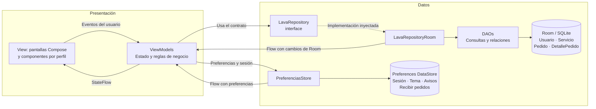
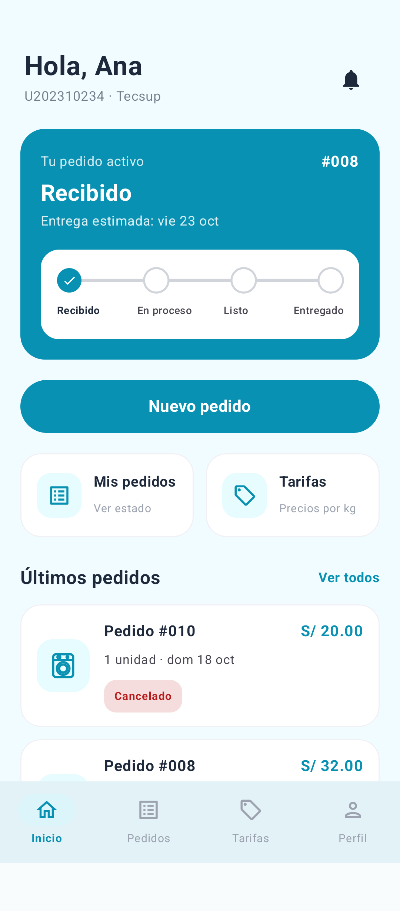
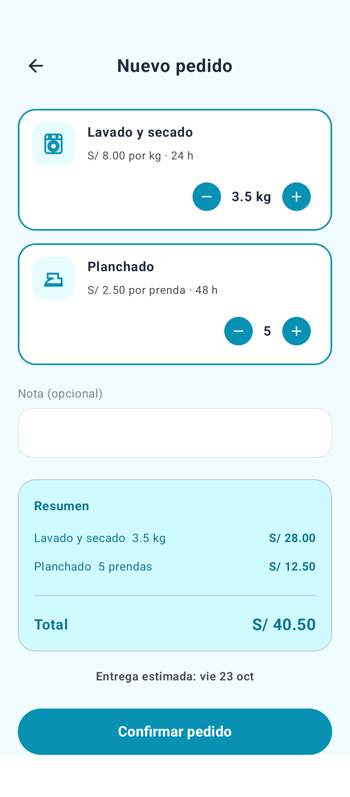
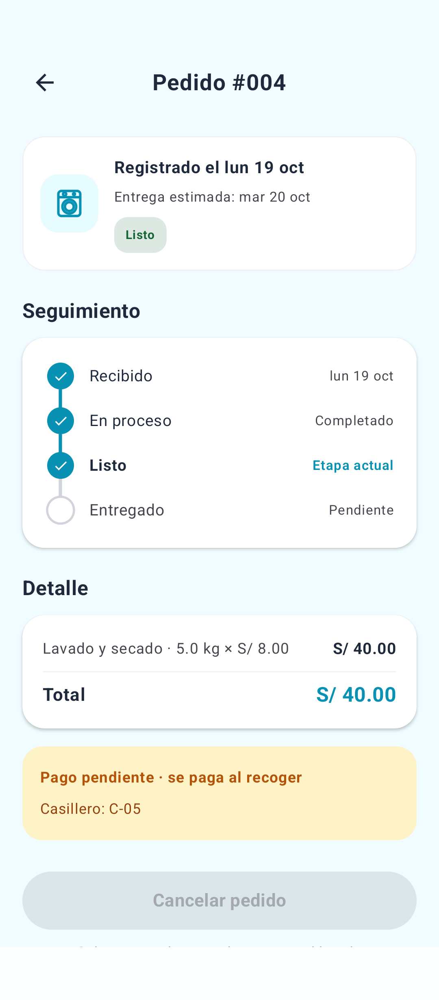
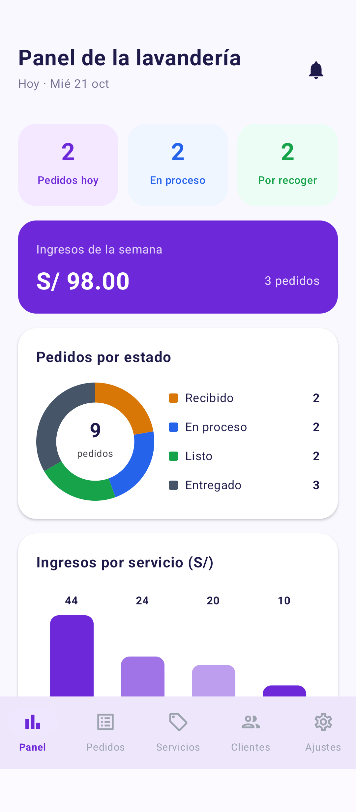
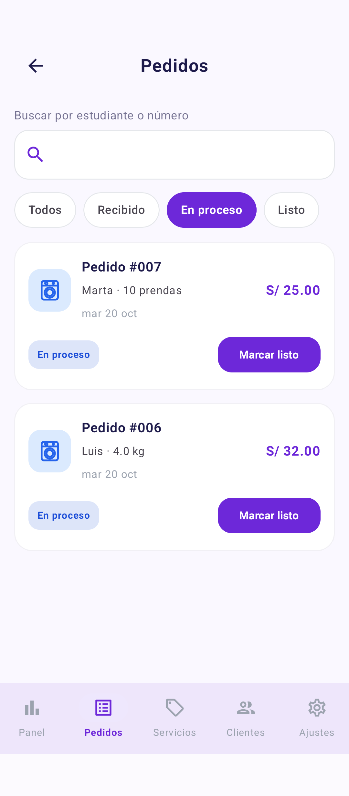
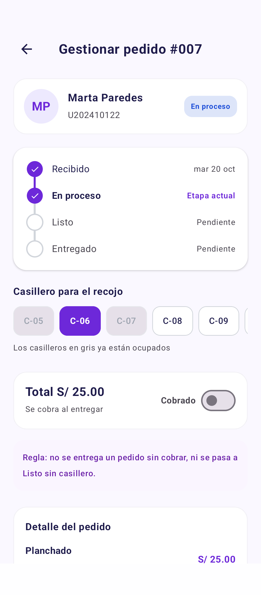
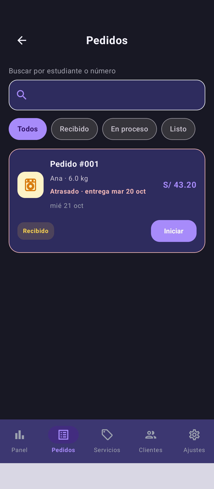
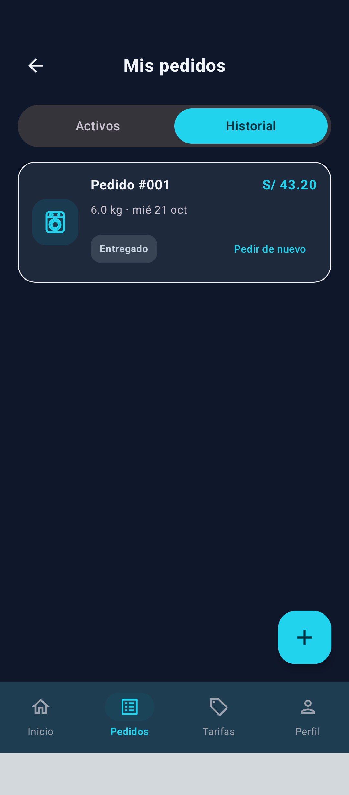
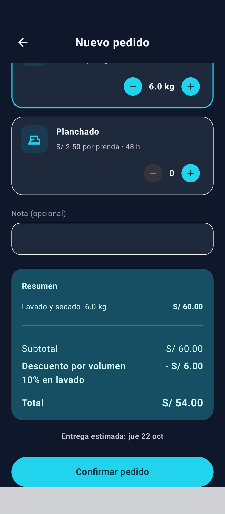

# LavaCampus

Aplicación Android para gestionar la lavandería de un campus. El estudiante registra pedidos, consulta su seguimiento y ubica el casillero de recojo. El administrador administra los servicios, organiza los pedidos, asigna casilleros y registra los cobros.

Proyecto del laboratorio de **Semana 08 de Programación en Móviles - TECSUP**, desarrollado con **MVVM + Repository**, Jetpack Compose y persistencia local con Room y DataStore.

## Funcionalidades

| Perfil | Funciones |
| --- | --- |
| Estudiante | Inicio con pedido activo y últimos pedidos; nuevo pedido con cantidades, total y entrega estimada; detalle y seguimiento; pedidos activos e historial; tarifas; cancelación antes de iniciar el lavado; perfil y preferencias. |
| Administrador | Panel con contadores e ingresos; bandeja con búsqueda y filtros; gestión de estados, casilleros y cobros; creación, edición y desactivación de servicios; clientes con cantidad de pedidos y gasto; ajustes y recepción de pedidos. |
| Ambos | Inicio de sesión, cambio de perfil en modo práctica, modo claro/oscuro y recuperación de sesión y preferencias al volver a abrir la app. |

### Reglas de negocio

- Un estudiante puede tener como máximo **3 pedidos activos**.
- Lavado por kilos: de **1 a 10 kg**, con incrementos de **0.5 kg**. Por prenda o unidad se usan cantidades enteras.
- El total se obtiene de las cantidades y precios seleccionados. Cada detalle conserva su precio unitario al crear el pedido.
- La entrega toma el mayor plazo de los servicios: **24, 48 o 72 horas**, expresadas en días. Si la fecha resultante cae domingo, pasa al lunes.
- El estudiante solo cancela pedidos **Recibidos**; el administrador puede cancelar pedidos **Recibidos** o **En proceso**.
- No se pasa a **Listo** sin un casillero disponible y no se entrega un pedido sin registrarlo como **Cobrado**.
- Un servicio asociado a pedidos no se elimina; puede desactivarse. Los servicios desactivados no aparecen al crear pedidos.
- Si se apaga **Recibir pedidos**, el estudiante ve el aviso y no puede confirmar un pedido nuevo.

## Tecnologías

| Tecnología | Uso |
| --- | --- |
| Kotlin 2.2.10 | Lenguaje y coroutines. |
| Jetpack Compose / Material 3 | Pantallas, componentes y temas por perfil. |
| Navigation Compose 2.8.2 | Navegación y limpieza de la pila al cambiar de perfil. |
| ViewModel + StateFlow | Estado de pantalla y actualización reactiva. |
| Room 2.8.5 + KSP 2.3.12 | SQLite, consultas, relaciones y transacciones. |
| Preferences DataStore 1.1.1 | Sesión, tema, avisos y recepción de pedidos. |
| JUnit / AndroidX Test / Compose UI Test | Pruebas de aceptación, persistencia e interfaz. |

**Compatibilidad:** se utiliza Room **2.8.5** en lugar de 2.6.1 por compatibilidad con Kotlin y KSP. La base está en la **versión 3**, con migraciones **1 → 2 → 3** que conservan los servicios y pedidos existentes. La versión 3 agrega subtotal y descuento sin recalcular los pedidos históricos.

## Estructura de paquetes

Árbol resumido del código de la aplicación:

```text
app/src/main/java/com/tecsup/lavacampus/
├── LavaApp.kt                         # Inicialización, dependencias y siembra
├── MainActivity.kt                    # Entrada a Compose y barras del sistema
├── data/
│   ├── local/
│   │   ├── LavaDatabase.kt            # Room y migraciones 1 -> 2 -> 3
│   │   ├── DatosIniciales.kt          # Servicios, usuarios y pedidos de demostración
│   │   ├── entity/                    # Usuario, Servicio, Pedido, DetallePedido
│   │   ├── dao/                       # UsuarioDao, ServicioDao, PedidoDao, DetalleDao
│   │   └── relation/                  # PedidoConDetalle, DetalleConServicio
│   ├── prefs/
│   │   └── PreferenciasStore.kt       # Preferences DataStore
│   └── repository/
│       ├── LavaRepository.kt          # Contrato utilizado por los ViewModels
│       └── LavaRepositoryRoom.kt      # Implementación con los DAOs
├── model/                             # Roles, estados, casilleros y modelos de resumen
├── viewmodel/                         # Sesión, pedidos, panel, servicios y preferencias
├── ui/
│   ├── estudiante/                    # Login, inicio, nuevo pedido, detalle, pedidos y tarifas
│   ├── administrador/                 # Panel, bandeja, gestión, servicios, formulario y clientes
│   ├── components/
│   │   ├── PerfilAjustesScreen.kt      # Perfil/Ajustes compartidos, adaptados al rol
│   │   ├── graficos/                  # Barras y dona con Canvas
│   │   └── ...                        # Botones, tarjetas, navegación y seguimiento
│   ├── navigation/
│   │   └── NavGraph.kt                # Rutas de ambos perfiles
│   ├── theme/                         # Colores, tipografía y modo oscuro
│   └── util/                          # Presentación de servicios
└── util/
    └── FechaUtils.kt                  # Formato de fechas y cálculo de entrega

app/src/androidTest/java/com/tecsup/lavacampus/
├── AceptacionLaboratorioTest.kt        # Reglas del Paso 14 con datos aislados
├── AdministracionPersistenciaTest.kt   # Servicios, precios históricos y DataStore
├── CapturasReadmeTest.kt               # Seis capturas y controles de interfaz
├── ContrasteVisualTest.kt              # Aviso y resumen en ambos temas
└── PerfilNavegacionTest.kt             # Cambio de perfil y preferencias
```

## Diagrama MVVM



Las pantallas muestran el estado y envían acciones al ViewModel: **no consultan DAOs ni repositorios**. Los ViewModels usan el contrato `LavaRepository`; `LavaApp` proporciona su implementación y `PreferenciasStore`. Los cambios de Room se observan como `Flow`, se exponen a la interfaz como `StateFlow` y actualizan el seguimiento sin volver a abrir la pantalla.

## Ejecutar la aplicación

1. Clonar o descargar el repositorio y abrir **`Semana08/LavaCampus`** en Android Studio.
2. Usar el JDK integrado de Android Studio, instalar el SDK **API 37** y sincronizar Gradle.
3. Conectar un dispositivo o iniciar un emulador con **Android 8.0 / API 26 o superior**.
4. Ejecutar **app** e iniciar sesión con una cuenta de demostración y el perfil correspondiente.

Desde PowerShell, dentro de `Semana08/LavaCampus`:

```powershell
.\gradlew.bat :app:assembleDebug
```

### Cuentas de demostración

| Perfil | Usuario | Correo | Clave |
| --- | --- | --- | --- |
| Estudiante | Ana García | `ana@correo.test` | `1234` |
| Estudiante | Luis Ramos | `luis@correo.test` | `1234` |
| Estudiante | Marta Paredes | `marta@correo.test` | `1234` |
| Administrador | Administración | `admin@lavacampus.test` | `admin` |

Los datos de demostración se cargan en una instalación nueva. Si ya existen usuarios, la siembra no vuelve a insertarlos. **Cambiar de perfil** corresponde al modo práctica del laboratorio y conserva la cuenta utilizada al regresar al perfil anterior.

## Capturas de pantalla

Seis capturas de las pantallas reales de la app en un dispositivo Android, con datos de demostración en una base de prueba. No son diseños generados ni imágenes del PDF.

### Estudiante

| Inicio y seguimiento | Nuevo pedido y resumen | Detalle del pedido |
| :---: | :---: | :---: |
|  |  |  |

### Administrador

| Panel de la lavandería | Bandeja de pedidos | Gestión de pedido |
| :---: | :---: | :---: |
|  |  |  |

## Pruebas de aceptación - Paso 14

**Resultado: 12 pruebas de aceptación aprobadas**, cubiertas por **13 casos automatizados** en un dispositivo Xiaomi 23053RN02L con Android 15. Las pruebas de reglas y persistencia usan bases y preferencias separadas de los datos actuales del usuario.

| N.º | Prueba | Resultado esperado | Estado |
| --- | --- | --- | --- |
| 1 | Login con clave incorrecta | Error; no inicia sesión. | OK |
| 2 | Nuevo pedido sin servicios | Confirmar pedido deshabilitado. | OK |
| 3 | 3.5 kg de lavado + 5 prendas de planchado | S/ 40.50 y entrega a 48 h, pasando al lunes si cae domingo. | OK |
| 4 | Crear un cuarto pedido activo | Mensaje de límite; no se inserta el pedido. | OK |
| 5 | Estudiante cancela un pedido En proceso | No permite la cancelación. | OK |
| 6 | Pasar a Listo sin casillero | Rechaza el cambio con un mensaje. | OK |
| 7 | Elegir un casillero ocupado | Gris y sin acción para seleccionarlo. | OK |
| 8 | Entregar sin cobrar | Rechaza la entrega; al registrar el cobro, la permite. | OK |
| 9 | Ver un cambio de estado desde el estudiante | Se actualiza sin cerrar la pantalla. | OK |
| 10 | Ingresos de la semana | Suma de pedidos pagados de esa semana. | OK |
| 11 | Eliminar un servicio usado | Conserva el servicio y muestra el mensaje. | OK |
| 12 | Cerrar y abrir | Conserva pedidos, perfil y modo oscuro. | OK |

Se comprueban también fechas deterministas: **miércoles 21/10/2026 + 48 h = viernes 23/10/2026** y **viernes 23/10/2026 + 48 h = lunes 26/10/2026**.

## Fase 2 — Mejoras con IA

Rama: **`mejora-ia-lavacampus`**, basada en `main`. Se usó **Codex** tras agotarse la cuota de Gemini. Se implementaron las tres mejoras de los commits mínimos del laboratorio; la trazabilidad está en [PROMPTS.md](PROMPTS.md).

| Mejora | Uso y criterio |
| --- | --- |
| Pedidos atrasados | La bandeja resalta en rojo los pedidos con entrega anterior a hoy; excluye Entregado y Cancelado. El panel muestra el contador y se actualiza al cambiar el estado o el día. |
| Descuento por volumen | Más de 5 kg de lavado aplica 10 % al importe de las líneas KG. El resumen muestra subtotal, descuento y total; se guardan en Room. Exactamente 5 kg y los servicios por prenda/unidad no se descuentan. |
| Repetir un pedido | Historial → **Pedir de nuevo** abre Nuevo pedido con las mismas cantidades y tarifas actuales, nota y fecha recalculada. Se puede editar antes de confirmar. Los servicios inactivos se omiten con aviso. El original no cambia. |

Ejemplo de descuento: 6 kg a S/ 8.00 = subtotal S/ 48.00, descuento S/ 4.80 y **total S/ 43.20**. Al repetirlo si el precio actual sube a S/ 10.00/kg, el resumen muestra S/ 60.00 − S/ 6.00 = **S/ 54.00**. Se conservan el límite de tres pedidos activos, los rangos de cantidad y la opción Recibir pedidos.

### Evidencia de las mejoras

Capturas reales obtenidas con datos de prueba aislados y tema oscuro:

| Marca de atraso | Repetir desde historial | Resumen con tarifa actual y descuento |
| :---: | :---: | :---: |
|  |  |  |

### Validación de Fase 2

**22 casos automatizados aprobados** en Xiaomi 23053RN02L / Android 15: 21 de reglas, persistencia y migración, y 1 de interfaz. Los registros completos están en [pruebas-mejoras.txt](docs/pruebas-mejoras.txt) y [pruebas-mejoras-ui.txt](docs/pruebas-mejoras-ui.txt).

- `MejoraAtrasadosTest`: fechas anteriores/hoy/futuras, exclusión de estados finales y actualización de bandeja/panel.
- `MejoraDescuentoTest`: umbral estricto, pedido mixto, persistencia, precios históricos e ingresos netos.
- `MigracionVolumenTest`: migración 2 → 3 conservando filas y totales antiguos.
- `MejoraRepetirTest`: precios y fecha actuales, edición y confirmación, servicios inactivos, propietario y límite de activos.
- `MejorasVisualTest`: atraso visible, botón del historial y resumen con descuento legible en modo oscuro.
- Regresión: `AceptacionLaboratorioTest` y `AdministracionPersistenciaTest`.

Compilación desde PowerShell:

```powershell
.\gradlew.bat :app:assembleDebug :app:assembleDebugAndroidTest
```

Las pruebas de reglas usan Room en memoria y DataStore temporal. Para ejecutarlas en un dispositivo ya utilizado se instalaron ambas APK con `adb install -r` y se invocó el runner de instrumentación; así se conserva la aplicación y sus datos. La [comparación con el respaldo previo](docs/verificacion-datos-mejoras.txt) confirmó 4 usuarios, 4 servicios, 10 pedidos y 14 detalles sin cambios y preferencias idénticas tras la migración.

### Commits del laboratorio

1. `ia: agrega pedidos atrasados en la bandeja`
2. `ia: agrega descuento por volumen`
3. `ia: agrega repetir un pedido`
4. `docs: agrega PROMPTS.md`
