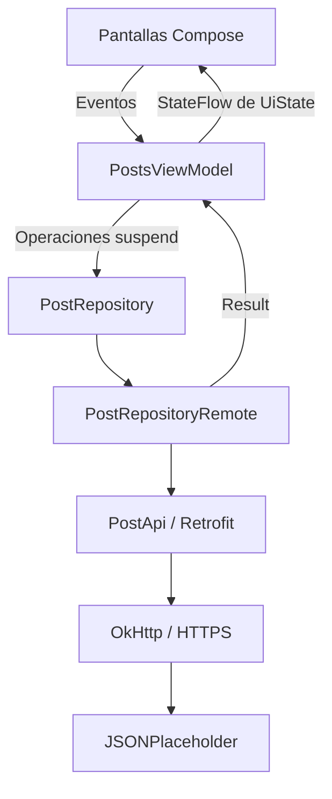
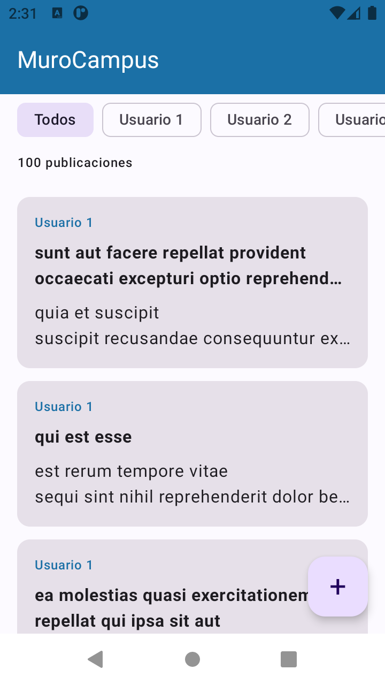
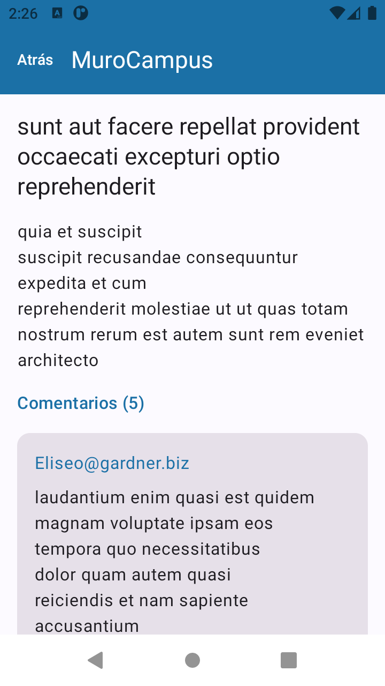
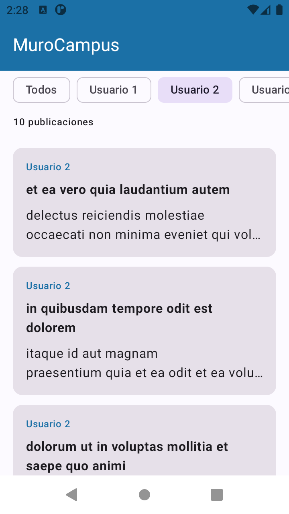
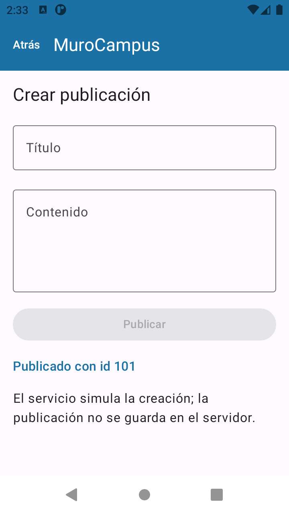
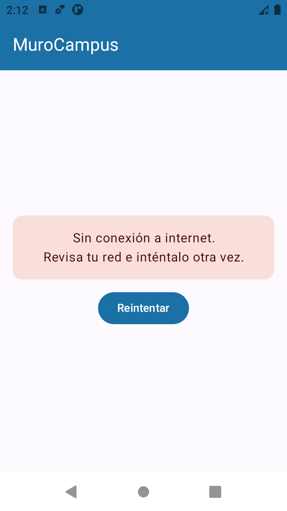
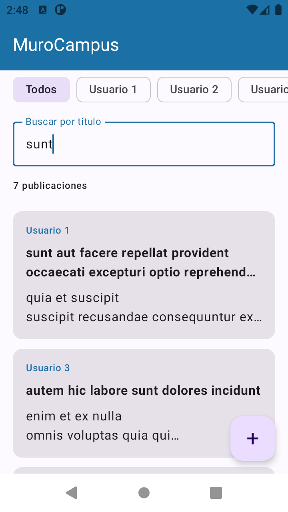
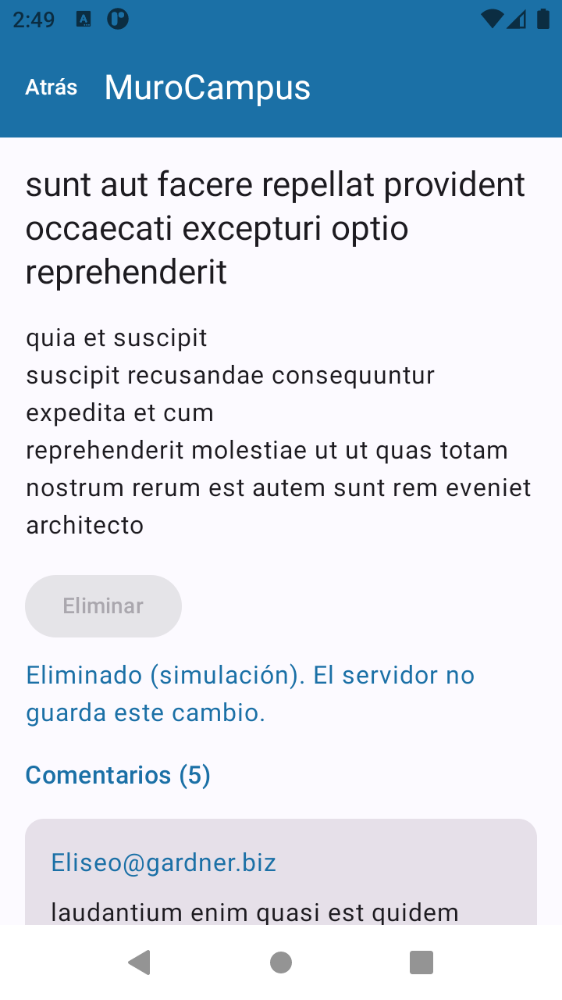

# MuroCampus

Aplicación Android de práctica que consume JSONPlaceholder para listar publicaciones, consultar su detalle y comentarios, filtrar por usuario y simular la creación de una publicación. Proyecto del laboratorio de la Semana 09 de Programación en Móviles.

## Construcción

- Abrir `Semana09/MuroCampus` en Android Studio y sincronizar Gradle.
- Usar JDK 17 o superior compatible con el Gradle del proyecto y Android SDK 37.
- El dispositivo necesita Android 8.0 (API 26) o superior y conexión a internet.
- Compilar con `.\gradlew.bat :app:assembleDebug`.
- Ejecutar pruebas locales con `.\gradlew.bat :app:testDebugUnitTest`.

El paquete es `com.eneque.murocampus`. La estructura inicial se construyó desde la plantilla Compose: no se recibió un proyecto base del docente. Se conserva el repositorio de todo el curso.

## Arquitectura

```text
com.eneque.murocampus/
├── MainActivity.kt
├── model/Modelos.kt
├── data/
│   ├── ErroresRed.kt
│   ├── PostRepository.kt
│   └── remote/
│       ├── AcceptJsonInterceptor.kt
│       ├── PostApi.kt
│       └── RetrofitClient.kt
├── viewmodel/
│   ├── UiState.kt
│   ├── DetalleUi.kt
│   ├── PostsViewModel.kt
│   └── PostsViewModelFactory.kt
└── ui/
    ├── Componentes.kt
    ├── PantallaLista.kt
    ├── PantallaDetalle.kt
    ├── PantallaCrear.kt
    └── theme/
```



La UI recoge los estados con `collectAsStateWithLifecycle()`. El ViewModel depende de la interfaz del Repository. Los detalles de transporte y la traducción de errores están en `data/`; el ViewModel no importa Retrofit, PostApi, HttpException ni Context. El Repository devuelve los fallos como `Result.failure` y siempre relanza `CancellationException`.

El ejemplo de Usuario de la guía también está incluido en los modelos, la API y el Repository.

## Servicio y límites

URL base: https://jsonplaceholder.typicode.com/

| Operación | Solicitud |
| --- | --- |
| Lista | GET posts |
| Detalle | GET posts/{id} |
| Comentarios | GET posts/{id}/comments |
| Filtro | GET posts?userId=N |
| Crear | POST posts |
| Eliminar (Fase 2) | DELETE posts/{id} |

JSONPlaceholder devuelve 100 publicaciones, 10 por usuario y 5 comentarios por publicación. El POST responde con id 101 y código 201, pero **no guarda la publicación**. Por eso no aparecerá al recargar la lista.

El registro BODY de OkHttp solo está activo en debug y se usa únicamente con los datos ficticios del laboratorio.

## Capturas de la Fase 1

| Lista | Detalle |
| --- | --- |
|  |  |

| Filtro por Usuario 2 | Crear |
| --- | --- |
|  |  |



## Verificación de la Fase 1

- Compilación y sincronización de Gradle correctas.
- Logcat de la prueba temporal de Retrofit: **Llegaron 100 publicaciones**. El código temporal se retiró antes del commit.
- Lista y detalle sin conexión: mensaje de error y recuperación mediante Reintentar.
- Rotación: la lista conserva su estado.
- Navegación Atrás: vuelve a la lista ya descargada.
- Formulario vacío: Publicar deshabilitado. POST real desde la pantalla: id 101 y formulario limpio.
- Pruebas locales: **6 aprobadas**, incluidos conversión a Result, cancelación y JSON con campos adicionales/obligatorios.
- Pruebas instrumentadas contra la API real: **4 aprobadas**, incluidos el contexto de la app y tres pruebas del servicio. Se verificaron los diez usuarios, detalles 1, 2, 11, 50 y 100, 404 y el cuerpo del POST.
- Pruebas instrumentadas adicionales: **2 aprobadas**, para cancelación del detalle y fallo de comentarios sin éxito parcial.
- Revisión estática de `viewmodel/`: sin Retrofit, PostApi, HttpException, Context ni GlobalScope.

Las pruebas de JSON y 404 usan entradas controladas o llamadas específicas: no se dejan rutas ni modelos temporalmente alterados en la aplicación. Las pruebas instrumentadas contra la API dependen de la disponibilidad de JSONPlaceholder.

Comandos adicionales:

```powershell
.\gradlew.bat :app:connectedDebugAndroidTest
```

## Para pensar

1. **GET y POST; Body y Query.** GET consulta recursos; POST envía una representación para crear uno. `@Body` serializa el objeto NuevoPost como JSON en el cuerpo. `@Query("userId")` agrega un parámetro a la URL para filtrar una consulta.
2. **posts y /posts.** Una ruta relativa se resuelve respecto de la ruta de la URL base. La barra inicial reemplaza ese camino desde la raíz del servidor. Aunque con esta URL base ambos pueden coincidir, usar rutas relativas permite conservar un prefijo como /api/ al cambiar de servidor.
3. **Result en Repository.** Hace explícitos el éxito y el error y permite que el ViewModel transforme el resultado en estado de UI sin conocer las excepciones de Retrofit. La cancelación se relanza para respetar el ciclo de vida.
4. **INTERNET e ignoreUnknownKeys.** Sin el permiso, la aplicación no puede conectarse aunque el dispositivo tenga red. Sin `ignoreUnknownKeys`, un campo adicional desconocido puede provocar un error de deserialización. Esta opción no permite omitir propiedades obligatorias que sí espera nuestro modelo.
5. **Un UiState y when.** Representa estados mutuamente excluyentes y permite comprobar exhaustivamente qué debe dibujarse. Tres booleanos independientes podrían representar combinaciones contradictorias, como cargar y mostrar éxito a la vez.
6. **Un servicio real.** Las publicaciones creadas serían persistentes, tendrían identificadores reales y aparecerían en consultas posteriores. Habría que actualizar la lista según la respuesta, definir autenticación y permisos, y gestionar validaciones y errores del servidor. Los reintentos de POST requerirían evitar duplicados, por ejemplo mediante claves de idempotencia.

## Fase 2: mejora-ia-murocampus

Se implementaron tres mejoras, cada una con su commit:

1. **Búsqueda local por título.** Filtra las publicaciones descargadas sin nuevas peticiones. Ignora mayúsculas y espacios exteriores; borrar la consulta recupera la lista cargada. Se combina con el filtro por usuario.
2. **Eliminar publicación.** DELETE con `Response<Unit>`, validación del código HTTP en el Repository, estado de envío y error en el ViewModel, y confirmación y reintento en la pantalla.
3. **Encabezado Accept.** Un interceptor agrega un solo `Accept: application/json` a todas las peticiones, también en release. El registro BODY sigue limitado a debug.

JSONPlaceholder también **simula DELETE**: responde 200 pero el recurso seguirá existiendo en las consultas siguientes. La app muestra este límite y conserva la lista original.

Validación de las mejoras:

- **8 pruebas locales aprobadas**: incluyen comprobación de 200/500 al eliminar y del interceptor sin acceder a internet.
- **8 pruebas instrumentadas aprobadas**: incluyen búsqueda sin nuevas consultas, cancelación, fallos de detalle y pruebas contra JSONPlaceholder.
- Prueba manual: buscar `sunt` devuelve 7 coincidencias; confirmar Eliminar muestra el éxito de la simulación.
- Logcat: GET y DELETE incluyen `Accept: application/json`; DELETE devuelve 200.
- La app final compila y está instalada en el emulador.

| Búsqueda | Eliminación simulada |
| --- | --- |
|  |  |

Las instrucciones de trabajo, respuestas y decisiones técnicas se registran en [PROMPTS.md](PROMPTS.md).

## Historial y uso de IA

La Fase 1 se desarrolla por pasos en `main`; la Fase 2 en `mejora-ia-murocampus`. El docente autorizó IA para ambas fases, según la indicación recibida por el estudiante. El rediseño visual con Claude se hará después de completar el laboratorio.

Las cinco capturas originales corresponden a la Fase 1. Esta rama conserva esa evidencia y agrega las tres mejoras funcionales. El rediseño visual aún no se ha aplicado.
