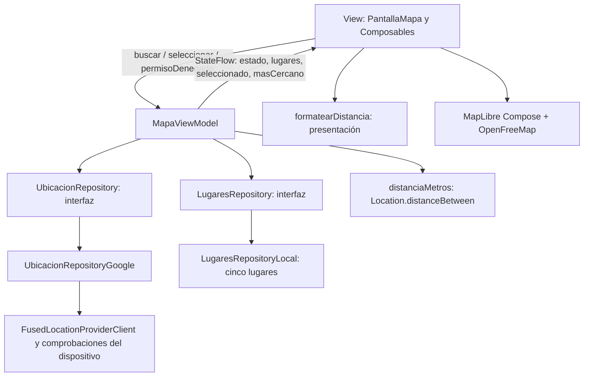
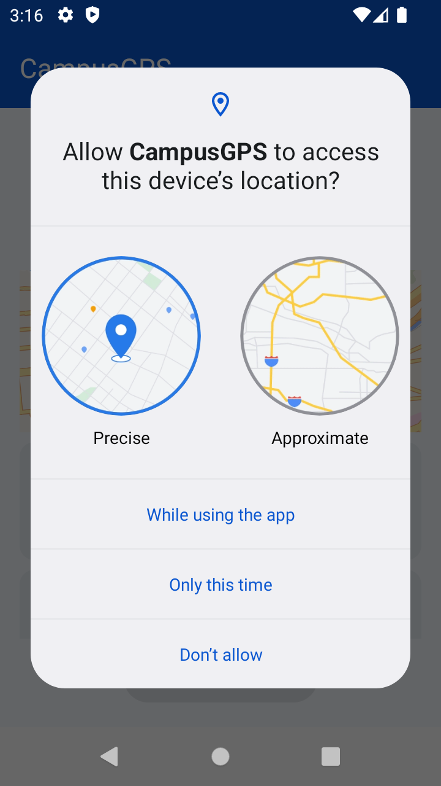
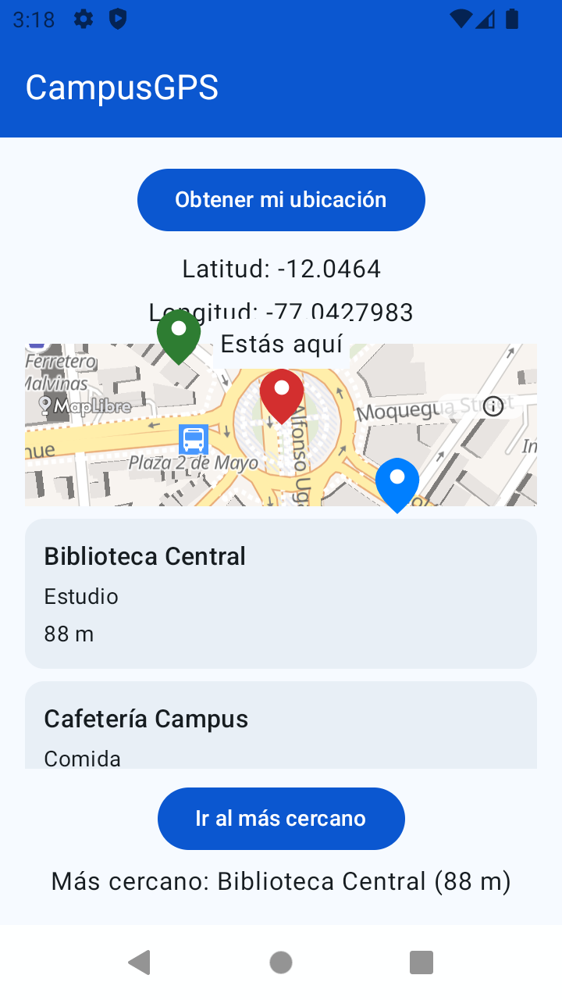
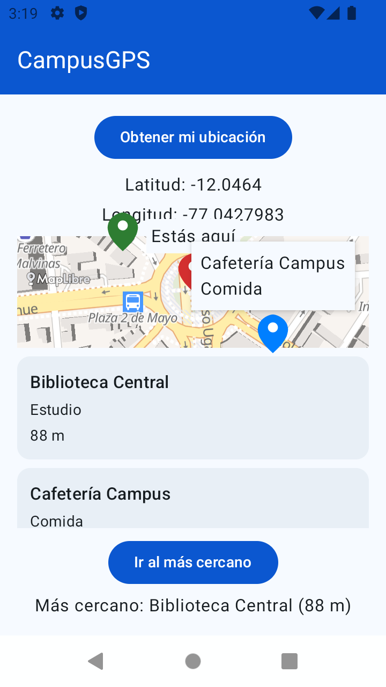
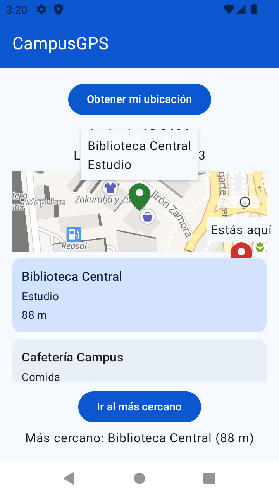
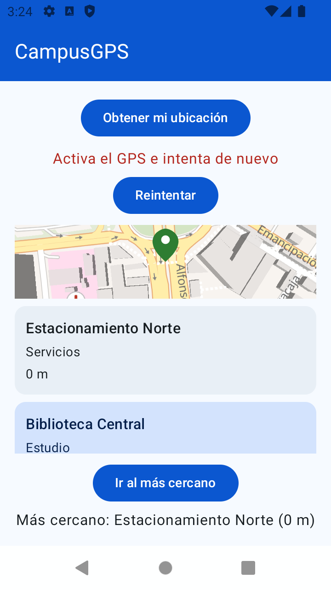

# CampusGPS

Laboratorio 13 de Programación en Móviles. Aplicación Android que obtiene la ubicación del usuario, muestra cinco lugares ficticios del campus en Lima y calcula sus distancias, ordenadas de menor a mayor.

Proyecto: `Semana13/Campusgps` · Paquete: `com.eneque.campusgps` · Rama de la Fase 1: `main`.

## Funcionalidades

- Solicitud de ubicación precisa o aproximada solo al tocar **Obtener mi ubicación**.
- Obtención de coordenadas mediante Google Play Services Location.
- Mapa  de Lima, centrado en **-12.0464, -77.0428**, con zoom 12.
- Marcador! [img.png](img.png) rojo **Estás aquí** y cámara con zoom 16 al obtener una posición válida.
- Cinco marcadores de lugares, con nombre y categoría; azules, excepto el más cercano, que es verde cuando hay distancias.
- Tarjetas ordenadas por distancia; **Sin calcular** antes de la primera búsqueda.
- Selección de tarjetas con resaltado y cámara al lugar con zoom 17.
- Botón **Ir al más cercano** y texto con su distancia.
- Errores con **Abrir ajustes** para permisos y **Reintentar** para ubicación no disponible.
- Comprobación de Play Services antes de consultar ubicación; mensaje sin botón de reintento cuando no están disponibles.

## Proveedor de mapas acordado

Con autorización del docente, esta implementación usa **MapLibre Compose + OpenFreeMap** en lugar de Google Maps Compose. El estilo es [OpenFreeMap Liberty](https://tiles.openfreemap.org/styles/liberty). La atribución del proveedor se mantiene visible en el mapa.

El mapa no requiere clave de Google Maps ni configurar facturación de Google Cloud. La ubicación sigue usando **Google Play Services Location**: cambiar el proveedor del mapa no reemplaza el servicio de ubicación.

Se conserva el runtime Vulkan de MapLibre y `AndroidRenderMode.Texture`, ajuste con el que se verificó la carga del mapa y su composición con los controles de Compose.

## Tecnologías y ejecución

| Configuración | Valor del proyecto |
| --- | --- |
| Lenguaje y plugin Compose | Kotlin 2.4.10 |
| Android Gradle Plugin | 9.5.1 |
| Compose BOM | 2026.02.01 |
| MapLibre Compose y runtime Vulkan | 0.20.0 |
| Google Play Services Location | 21.3.0 |
| UI | Jetpack Compose + Material 3 |
| Arquitectura | MVVM + Repository |
| SDK mínimo / compilación / destino | 26 / 37 / 37 |
| Entorno de aceptación | Small Phone API 31 Play, Android 12 |

1. Abre **Semana13/Campusgps** en Android Studio y sincroniza Gradle.
2. Instala los componentes del SDK solicitados por el proyecto.
3. Ejecuta `app` en un dispositivo o emulador con Google Play Services y acceso a Internet.
4. Activa la ubicación del dispositivo.
5. Pulsa **Obtener mi ubicación** y concede ubicación precisa o aproximada.

No se solicitan permisos al abrir la app. `local.properties` sirve para la configuración local del SDK y está ignorado por Git; esta versión no lee una clave de Maps desde ese archivo.

Desde PowerShell, en la carpeta del proyecto:

```powershell
.\gradlew.bat :app:assembleDebug
.\gradlew.bat :app:testDebugUnitTest
.\gradlew.bat :app:connectedDebugAndroidTest
```

Para reconstruir desde cero:

```powershell
.\gradlew.bat clean :app:assembleDebug
```

## Lugares ficticios

| Id | Lugar | Categoría | Latitud | Longitud |
| --- | --- | --- | --- | --- |
| 1 | Biblioteca Central | Estudio | -12.0460 | -77.0435 |
| 2 | Cafetería Campus | Comida | -12.0470 | -77.0420 |
| 3 | Laboratorio de Cómputo | Estudio | -12.0455 | -77.0415 |
| 4 | Auditorio Principal | Eventos | -12.0480 | -77.0440 |
| 5 | Estacionamiento Norte | Servicios | -12.0440 | -77.0430 |

Para simular el punto base en el emulador, usa **Extended controls > Location** o ADB. Primero identifica el dispositivo:

```powershell
adb devices -l
adb -s emulator-5554 emu avd name
adb -s emulator-5554 shell getprop ro.build.version.sdk
```

Solo si corresponde al emulador de prueba, envía el punto. **ADB recibe longitud primero y latitud después**:

```powershell
adb -s emulator-5554 emu geo fix -77.0428 -12.0464
```

El serial es un ejemplo: usa el que devuelva tu equipo. No hay coordenadas simuladas en el flujo de producción de la app.

En el punto base, el orden esperado es Biblioteca, Cafetería, Laboratorio, Auditorio y Estacionamiento, con distancias aproximadas de 88, 110, 173, 220 y 266 m. El formato en pantalla usa metros enteros por debajo de 1000 y kilómetros con un decimal desde 1000; por ejemplo, **350 m** y **1.5 km**. La truncación puede mostrar 109 m para una distancia de 109.5 m.

## Estructura

```text
app/src/main/java/com/eneque/campusgps/
├── MainActivity.kt
├── model/
│   └── Modelos.kt
├── data/
│   ├── UbicacionRepository.kt
│   ├── UbicacionRepositoryGoogle.kt
│   ├── LugaresRepository.kt
│   └── LugaresRepositoryLocal.kt
├── util/
│   ├── Distancia.kt
│   └── Formato.kt
├── viewmodel/
│   ├── MapaViewModel.kt
│   └── CampusViewModelFactory.kt
└── ui/
    ├── PantallaMapa.kt
    ├── MapaUbicacion.kt
    ├── ListaLugares.kt
    ├── MensajeError.kt
    └── theme/

app/src/test/java/com/eneque/campusgps/
├── ExampleUnitTest.kt
└── util/FormatoTest.kt

app/src/androidTest/java/com/eneque/campusgps/
├── ExampleInstrumentedTest.kt
├── DistanciasInstrumentedTest.kt
└── ErroresInstrumentedTest.kt
```

## MVVM + Repository



- **View:** dibuja el estado y envía eventos al ViewModel. Gestiona el diálogo de permisos y el Intent de ajustes. No consulta repositorios ni calcula distancias.
- **ViewModel:** solo recibe interfaces de repositorio, sin `Context`. Calcula y ordena distancias tras una ubicación correcta y publica estado con `StateFlow`.
- **Repository:** encapsula Play Services, permisos y disponibilidad de ubicación, o entrega los cinco lugares locales. No depende de Composables ni de tipos de error de UI.
- **util:** calcula distancia y da formato, sin almacenar estado.

## Pruebas de aceptación

Registro del Paso 9, realizado sobre el código del commit `7964b7c` en Small Phone API 31 Play. Se repitieron los flujos mediante ADB e interacción con la app. Una prueba automatizada con un repositorio controlado no equivale a probar el hardware o servicio real. Las limitaciones visuales detectadas se indican sin presentarlas como resueltas.

| Prueba | Resultado esperado | Estado |
| --- | --- | --- |
| Primera apertura y botón | Sin solicitud al iniciar; diálogo al tocar el botón | OK: reapertura sin permisos; captura 01 del diálogo tras tocar el botón |
| Aceptar permiso | Coordenadas y marcador rojo Estás aquí | OK: -12.0464, -77.0427983; captura 02 |
| Negar permiso | Error y Abrir ajustes; sin cierre | OK: denegación real y apertura de App info de CampusGPS |
| Ubicación en punto base | Cinco lugares; cuatro azules y uno verde tras calcular | OK: cinco marcadores en la jerarquía inicial; colores corroborados con las pruebas visuales |
| Tocar marcador | Nombre y categoría | OK: Cafetería Campus / Comida; captura 03; Estacionamiento Norte confirmado previamente por el usuario |
| Lista | Orden ascendente, distancias en m o km | OK: recorrida la lista; formato m/km cubierto por pruebas unitarias |
| Tocar tarjeta | Cámara al lugar y tarjeta resaltada | OK: Cafetería Campus seleccionada; vista de mapa desplazada |
| Ir al más cercano | Deshabilitado al inicio; cámara al marcador verde tras buscar | OK: deshabilitado inicialmente; desde Cafetería lleva a Biblioteca y resalta su tarjeta; captura 04 |
| Cambiar ubicación y buscar | Distancias, orden y marcador verde se actualizan | OK: segundo punto -12.0440, -77.0430; Estacionamiento primero con 0 m y Biblioteca con 227 m |
| Ubicación apagada | Mensaje de GPS y Reintentar; recuperación al activarla | OK: apagado real, captura 05 y recuperación al reactivar y pulsar Reintentar |
| Rotar pantalla | Se conservan ubicación y lista | Estado conservado; limitación visual: mapa y controles recortados en horizontal |
| Repositorio | Sin claves ni local.properties versionado | OK: archivo local y builds ignorados, sin versionar; búsqueda de patrón de clave de Google sin coincidencias en fuentes/configuración versionadas |

### Compilación y pruebas automatizadas

Se ejecutó desde cero:

```powershell
.\gradlew.bat clean :app:assembleDebug :app:testDebugUnitTest :app:connectedDebugAndroidTest '-Pandroid.testInstrumentationRunnerArguments.class=com.eneque.campusgps.DistanciasInstrumentedTest,com.eneque.campusgps.ErroresInstrumentedTest' --console=plain
```

Resultado: **BUILD SUCCESSFUL**, 75 tareas ejecutadas. Pruebas unitarias correctas y cinco pruebas instrumentadas correctas, sin fallos ni ignoradas.

Las pruebas instrumentadas verifican distancias, orden, recálculo solo en éxito, clasificación de errores y recuperación. El caso **sin Play Services** se verificó con un repositorio de prueba; falta una prueba manual en un dispositivo sin esos servicios.

El error **SERVICE_INVALID** se presentó en el emulador anterior API 30. En **Small Phone API 31 Play** se verificó la obtención de coordenadas y el marcador rojo en Lima.

### Capturas

Capturas reales del emulador, guardadas con `adb shell screencap` y `adb pull`, sin recrear interfaces ni introducir datos simulados en el código de producción. La lista se desplaza verticalmente; una captura no muestra las cinco tarjetas a la vez.

| Evidencia | Captura |
| --- | --- |
| Solicitud de permiso de Android |  |
| Coordenadas y ubicación actual |  |
| Marcadores y nombre/categoría |  |
| Lista ordenada y lugar más cercano |  |
| GPS apagado y acción de recuperación |  |

### Limitaciones observadas y pendientes

- Al rotar a horizontal se mantienen las coordenadas, los valores y la posición de la lista; la disposición actual no aprovecha ese tamaño de ventana y puede dejar el mapa sin altura y controles fuera de la pantalla. Falta corregir y repetir la verificación visual horizontal.
- Los marcadores y sus ventanas de información pueden salir de los límites del mapa y superponerse a las coordenadas o controles en Small Phone. Se conserva la evidencia real; falta corregir ese recorte.
- Si el usuario está exactamente sobre un lugar, el marcador rojo puede tapar el verde porque ambos comparten posición. El texto del lugar más cercano y la lista siguen identificándolo.
- La ausencia real de Play Services no se probó en otro dispositivo; la clasificación y la recuperación están cubiertas por pruebas instrumentadas con un repositorio controlado.
- La simulación se devolvió al punto base de Lima, con ubicación activa y rotación automática restaurada. No se cambiaron fuentes de producción durante el Paso 9.

El registro y las capturas permiten revisar el estado real. No se declara resuelta la adaptación horizontal ni el recorte de las ventanas del mapa.

## Para pensar

**1. ¿Por qué FusedLocationProviderClient está dentro del Repository y no en el ViewModel?**

Porque es una dependencia de plataforma que necesita `Context`, permisos y llamadas a Google Play Services. El Repository la encapsula detrás de una interfaz. El ViewModel trabaja con `Posicion` y resultados, y puede probarse con un repositorio controlado sin consultar el GPS real.

**2. ¿Qué diferencia hay entre el permiso de ubicación y la clave de API de Maps? ¿Qué pasa si falta cada uno?**

El permiso autoriza el acceso a la ubicación del dispositivo. Sin él, la app no debe consultar Fused Location y ofrece abrir ajustes. La clave de Google Maps identifica y autoriza el uso de ese proveedor de mapas; no concede acceso al GPS. En una integración con Google Maps, una clave ausente o inválida puede impedir cargar el mapa. CampusGPS usa MapLibre y OpenFreeMap, por lo que no requiere esa clave; sí conserva permisos de ubicación e Internet.

**3. ¿Por qué la clave va en local.properties y no en el código? ¿Qué harías si se subiera a GitHub por error?**

En la variante original de la guía, `local.properties` evita incluir la configuración privada de desarrollo en Git. No convierte una clave empaquetada en el APK en un secreto: también se necesitan restricciones de paquete, certificado y API. Si una clave se publica, hay que revocarla o rotarla, revisar restricciones y uso, y retirarla del repositorio y del historial cuando corresponda. Esta implementación no usa una clave de Maps y mantiene `local.properties` ignorado.

**4. ¿Dónde calculas la distancia y por qué no en el Composable?**

`distanciaMetros` llama a `Location.distanceBetween`. El ViewModel la usa en `actualizarDistancias` únicamente después de obtener una posición correcta, crea `LugarConDistancia`, ordena y publica la lista. El Composable solo presenta esos valores; la recomposición no dispara cálculos ni consultas.

**5. ¿Qué pasa si el usuario niega el permiso dos veces? ¿Cómo lo manejas?**

Android puede dejar de mostrar el diálogo tras denegaciones repetidas. CampusGPS mantiene un error de permiso y ofrece **Abrir ajustes** para cambiarlo manualmente. No solicita permisos al iniciar ni reintenta en un bucle. Al volver, el botón comprueba otra vez FINE o COARSE; el Repository también verifica el permiso antes de consultar ubicación.

## Estado de entrega

La documentación y capturas de la Fase 1 se subieron a `main` en el commit `2589c48`. Las limitaciones visuales indicadas arriba siguen pendientes.

## Fase 2: mejoras con IA

La rama de CampusGPS es **`mejora-ia-campusgps`**, creada desde `main` en `2589c48`. Se utiliza este nombre para distinguirla de la rama `mejora-ia` de otra semana del mismo repositorio.

La bitácora técnica y las decisiones de implementación se encuentran en [PROMPTS.md](PROMPTS.md).

| Mejora elegida de la guía | Estado |
| --- | --- |
| Filtro por categoría | Implementado; assembleDebug, pruebas unitarias y ocho pruebas instrumentadas correctas; revisión manual confirmada por el usuario |
| Radio de cercanía | Implementado; assembleDebug, pruebas unitarias y once pruebas instrumentadas correctas; círculo y clasificación comprobados en API 31 Play; revisión manual confirmada por el usuario |
| Último lugar seleccionado con DataStore | Pendiente |

### Filtro por categoría

- Chips **Todos, Estudio, Comida, Eventos y Servicios**, con desplazamiento horizontal.
- El ViewModel conserva los cinco lugares originales y deriva la lista visible.
- Mapa y tarjetas usan esa misma lista filtrada; se mantiene el orden por distancia.
- El marcador verde, el texto y el botón del más cercano consideran únicamente los lugares visibles.
- Si el filtro oculta la tarjeta seleccionada, se limpia la selección y se cierra su ventana del mapa.
- Cambiar de categoría no solicita permisos ni consulta ubicación.
- Al pulsar Todos se recuperan los cinco lugares y las distancias calculadas.

Archivos principales: `viewmodel/MapaViewModel.kt`, `ui/FiltrosCategorias.kt`, `ui/PantallaMapa.kt` y `ui/MapaUbicacion.kt`. Las pruebas están en `FiltrosInstrumentedTest.kt`.

Para comprobarlo en el emulador:

1. Antes de buscar ubicación, cambia entre categorías: Estudio muestra dos lugares y cada otra categoría muestra uno, todos con Sin calcular.
2. Pulsa Todos y verifica que regresan los cinco.
3. Obtén ubicación en el punto base y pulsa Comida: solo debe quedar Cafetería Campus, también como la más cercana visible.
4. Selecciona una tarjeta y elige una categoría que la excluya: la selección y su ventana deben desaparecer.
5. Vuelve a Todos: deben conservarse las distancias y el orden.
6. Con una categoría activa, busca de nuevo o rota: el filtro debe conservarse.

### Radio de cercanía

- Menú **Radio: 100 m** en la barra superior, con opciones **100, 200 y 500 m**; valor inicial de 100 m.
- Al obtener una ubicación válida, se dibuja un círculo azul translúcido con borde alrededor de la posición del usuario.
- El contorno geográfico se genera fuera de los Composables y se representa mediante GeoJSON en MapLibre. Es una aproximación esférica; no es un círculo de tamaño fijo en pantalla.
- Las tarjetas muestran **Dentro del radio** o **Fuera del radio**, usando el límite inclusivo de distancia menor o igual al radio.
- El radio señala cercanía sin ocultar lugares. El filtro por categoría, el orden y el lugar más cercano mantienen su comportamiento.
- Cambiar el radio no solicita permisos ni consulta ubicación. La selección del radio se conserva al rotar durante la misma sesión.
- Antes de obtener ubicación no se dibuja el círculo ni se clasifican las tarjetas. Si hay un error, se oculta el círculo y se conservan las últimas distancias de la lista.
- La cámara conserva su comportamiento previo. Puede ser necesario alejar el mapa para ver el círculo completo, especialmente con 500 m.
- Botones de zoom verticales **+** y **−** en el lateral derecho; atribución expandible en la esquina inferior derecha y logo abajo a la izquierda.
- Latitud y longitud juntas en una fila centrada, con seis decimales; los cálculos usan las coordenadas completas.

Archivos añadidos: `util/Radio.kt` y `ui/SelectorRadio.kt`. La clasificación y el contorno se exponen desde `MapaViewModel`; las tarjetas y el mapa solo presentan esos valores.

Prueba de aceptación en el punto base de Lima, con **Todos** seleccionado:

| Radio | Lugares dentro |
| --- | --- |
| 100 m | Biblioteca Central |
| 200 m | Biblioteca Central, Cafetería Campus y Laboratorio de Cómputo |
| 500 m | Los cinco lugares |

Para probar la combinación, selecciona Comida: Cafetería sigue visible pero queda fuera con 100 m y dentro con 200 m. El botón del más cercano sigue apuntando a Cafetería en ambos casos.

Pruebas nuevas: `RadioTest` verifica límites y datos inválidos; `RadioInstrumentedTest` verifica la clasificación, el filtro, la actualización y el tamaño del contorno con la API real de distancias de Android. Los repositorios controlados solo se usan en androidTest.
