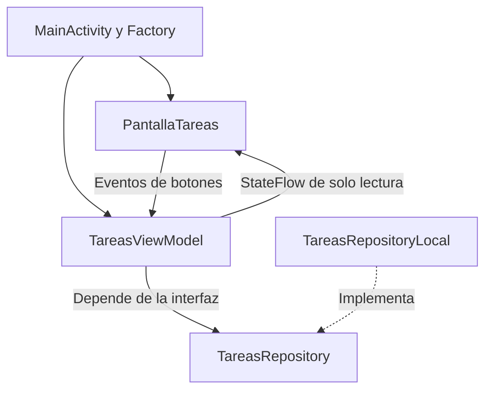
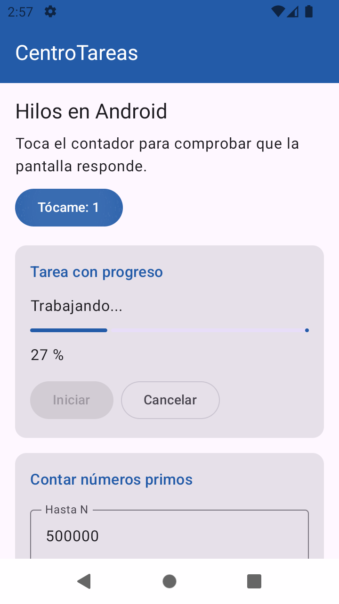
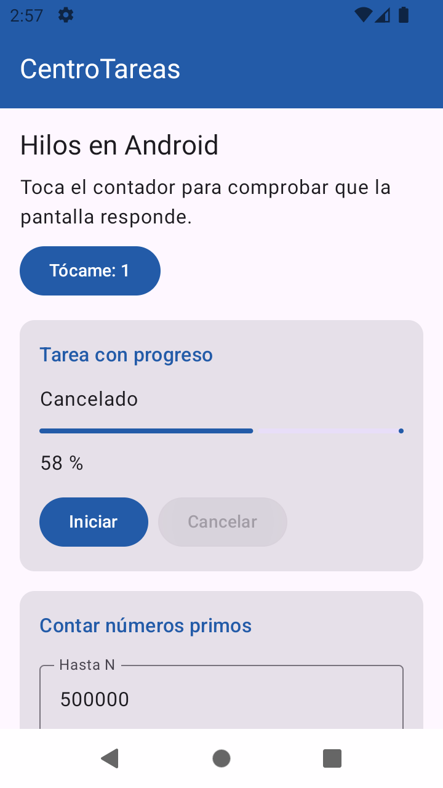
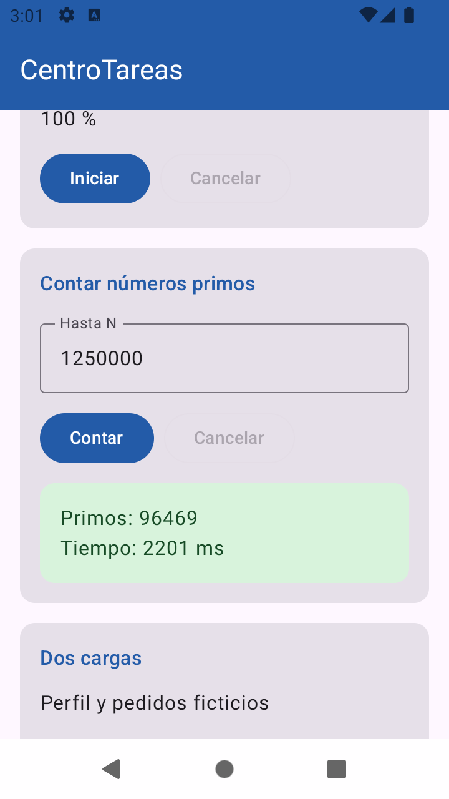
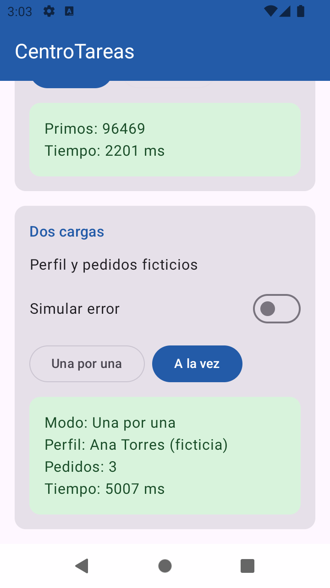
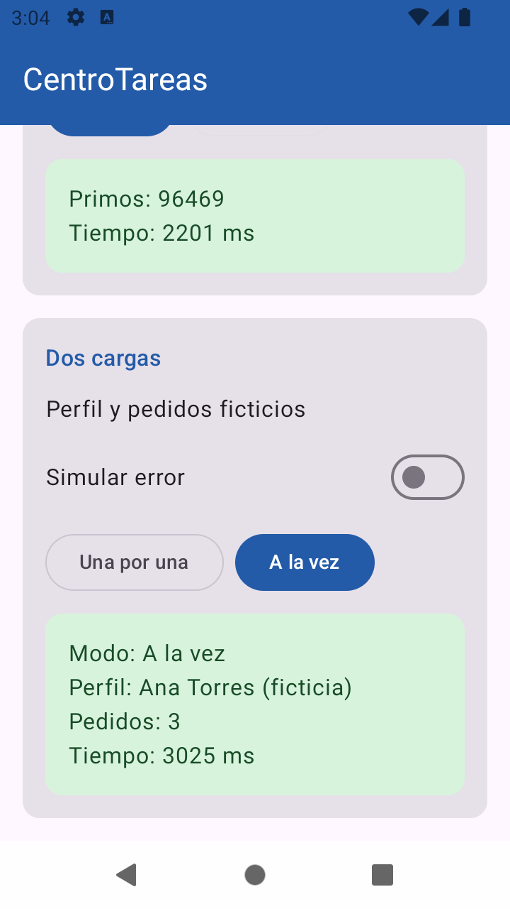
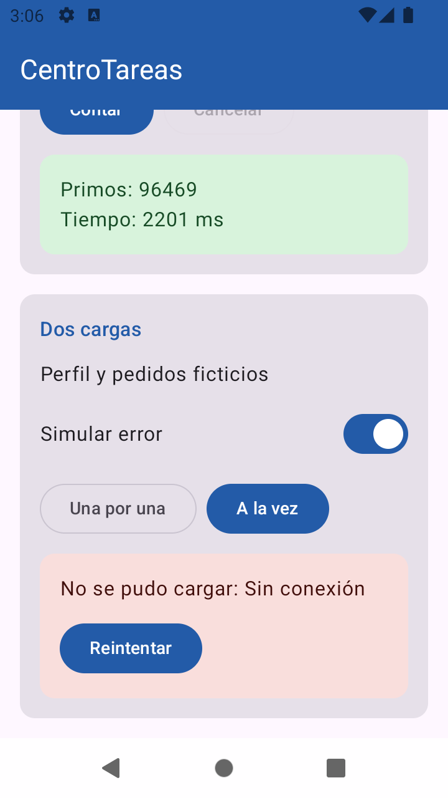
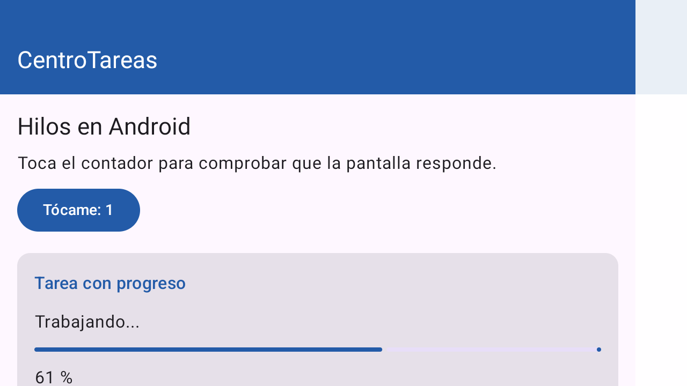

# CentroTareas

Laboratorio 14 de Programación en Móviles: **Hilos en Android**.

Aplicación en Kotlin, Jetpack Compose y Material 3 que demuestra cómo ejecutar
tareas largas sin congelar la pantalla. Usa corrutinas, ViewModel, StateFlow y
el patrón MVVM + Repository.

Repositorio: [OscarAEL/Moviles-Curso-OAEL](https://github.com/OscarAEL/Moviles-Curso-OAEL).
Proyecto: `Semana14/centrotareas`. Paquete: `com.eneque.centrotareas`.

El docente autorizó IA en ambas fases. Se construyó el proyecto base desde cero
y se conservó el repositorio existente, con un commit por paso.
La fase 1 queda cerrada y revisada en `main`. La fase 2 se desarrollará en
`mejora-ia-centrotareas`, para distinguirla de las ramas de otros proyectos
del mismo repositorio.

## Funcionalidades

| Tarjeta | Comportamiento |
| --- | --- |
| Tarea con progreso | Avanza de 0 a 100 % en unos 4 s; permite cancelar y reiniciar. |
| Contar números primos | Calcula en segundo plano, mide el tiempo y permite cancelar. |
| Dos cargas | Compara ejecución secuencial y paralela; permite simular un error y reintentar. |

**Tócame** cuenta los toques y sirve como prueba de respuesta de la pantalla.
Todos los datos son ficticios: Ana Torres y pedidos 101, 102 y 103.
No se necesita conexión a Internet para usar la app.

## Ejecutar y verificar

1. Abrir `Semana14/centrotareas` en Android Studio.
2. Sincronizar Gradle y ejecutar el módulo `app`.
3. Usar un dispositivo con Android API 26 o superior. Las pruebas funcionales
   se hicieron en **Small Phone API 31 PLAY**.
4. Desplazar la pantalla para acceder a las tres tarjetas.
5. Para revisar los cambios de hilo, filtrar Logcat por la etiqueta `HILO`.

Desde esta carpeta, en PowerShell:

```powershell
.\gradlew.bat :app:assembleDebug :app:testDebugUnitTest :app:lintDebug
.\gradlew.bat :app:connectedDebugAndroidTest
```

La primera sincronización requiere descargar las dependencias del proyecto.

## Estructura de paquetes

```text
app/src/main/java/com/eneque/centrotareas/
├── MainActivity.kt
├── data/
│   ├── TareasRepository.kt
│   └── TareasRepositoryLocal.kt
├── model/
│   └── Estados.kt
├── viewmodel/
│   ├── TareasViewModel.kt
│   └── TareasViewModelFactory.kt
└── ui/
    ├── PantallaTareas.kt
    └── theme/
        ├── Color.kt
        ├── Theme.kt
        └── Type.kt

docs/capturas/
├── 01-progreso.png
├── 02-cancelada.png
├── 03-primos.png
├── 04-secuencial.png
├── 05-paralela.png
├── 06-error.png
└── 07-rotacion.png
```

## Arquitectura MVVM + Repository



- **View:** recoge StateFlow con collectAsState, dibuja los estados y comunica
  eventos al ViewModel. No lanza corrutinas ni crea hilos.
- **ViewModel:** depende de la interfaz del Repository, mantiene los estados
  y lanza tareas con viewModelScope. No conoce Composables ni recibe Context.
- **Repository:** no conoce la UI. Las cargas usan delay y el cálculo de primos
  usa withContext(Dispatchers.Default) y ensureActive.
- **MainActivity y Factory:** conectan la implementación local con el ViewModel.
- **Estado de pantalla:** el contador y el texto del campo usan rememberSaveable;
  el trabajo y sus resultados viven en el ViewModel y sobreviven a la rotación.

En los pasos 2 a 4, la tarea con progreso permanece simulada en el ViewModel,
tal como pide el laboratorio. Moverla al Repository con Flow es una de las
mejoras posibles para la fase 2.

## Observación del Paso 1

Al pulsar **Tarea larga (MAL)**, el ViewModel publicaba `Trabajando...`,
bloqueaba el hilo principal con `Thread.sleep(4000)` y publicaba `Terminó`.

Durante esos cuatro segundos, Android no podía dibujar los cambios ni atender
los toques de la app. Por eso no se llegaba a ver `Trabajando...`: cuando
la pantalla podía actualizarse, el estado ya contenía `Terminó`.
El contador no se actualizaba durante la espera; los eventos podían procesarse
después del bloqueo.

Con una espera de diez segundos y eventos de entrada sin atender, Android
podría detectar un ANR y mostrar el diálogo de aplicación que no responde.
El diálogo depende de las condiciones y de los tiempos de detección del sistema.

El bloqueo fue exclusivamente una demostración temporal. Se eliminó en el
paso 2; el código Kotlin final no contiene Thread.sleep, GlobalScope ni runBlocking.
La versión bloqueante queda conservada en el commit `8b69163`.

## Corrutinas, progreso y cancelación

La tarea usa viewModelScope.launch, con 100 iteraciones de delay(40) dentro de
withContext(Dispatchers.Default). Publica progreso entre 0f y 1f.
Un Job permite cancelarla, y finally siempre restablece corriendo a false.
Al cancelar, conserva el porcentaje y muestra Cancelado. Un nuevo inicio
reinicia la barra. Iniciar se deshabilita mientras trabaja.

El cálculo de primos tiene un Job independiente. El Repository prueba divisores
hasta la raíz de cada número y usa `d.toLong() * d <= n` para evitar
desbordes. ensureActive comprueba la cancelación dentro del ciclo.
El ViewModel mide el tiempo con System.currentTimeMillis y, si captura
CancellationException, publica Cancelado y vuelve a lanzarla.

Contar se deshabilita para entradas vacías, no enteras, fuera del rango Int o
menores que 2, y mientras se está calculando. Cancelar solo se habilita durante
el cálculo.

### Resultados y calibración

| Hasta N | Primos esperados y comprobados |
| ---: | ---: |
| 100 | 25 |
| 1 000 | 168 |
| 10 000 | 1 229 |
| 100 000 | 9 592 |
| 500 000 | 41 538 |

El límite inicial se ajustó a **1 250 000** siguiendo la indicación del laboratorio:
con 500 000, la medición inicial fue 2153 ms, pero una ejecución posterior
bajó a 864 ms. Con 1 250 000 se obtuvieron **96 469 primos en 2201 ms**.
Los tiempos dependen del dispositivo y su carga; se puede editar N.

## Cargas y errores

**Una por una** espera el perfil (2 s) y luego los pedidos (3 s).
**A la vez** lanza ambas llamadas con async dentro de coroutineScope
y recoge los resultados con await.

| Modo | Tiempo aproximado | Medición de las capturas |
| --- | ---: | ---: |
| Una por una | 5000 ms | 5007 ms |
| A la vez | 3000 ms | 3025 ms |

En ambos casos el resultado es Ana Torres (ficticia) y 3 pedidos.
Mientras carga se muestra un indicador y se deshabilitan ambos botones
y el interruptor. El ViewModel también rechaza un segundo inicio.

Cada carga toma el valor de Simular error al iniciar. Si está activado,
cargarPedidos lanza IOException("Sin conexión").
La pantalla muestra **No se pudo cargar: Sin conexión** y **Reintentar**.
Reintentar ejecuta la modalidad A la vez: si el interruptor continúa activado,
falla de nuevo; si se desactiva, termina con éxito.

El catch común relanza CancellationException antes de manejar las demás
excepciones. Un error de las llamadas async sale de coroutineScope y cancela
cualquier tarea hermana que todavía esté pendiente.

## Pruebas de aceptación de la fase 1

Comprobaciones hechas en el emulador durante los pasos y su cierre:

- [x] Tócame sigue sumando durante la tarea con progreso.
- [x] Logcat HILO muestra main antes y después, y DefaultDispatcher-worker dentro.
- [x] La barra avanza de 0 a 100 % en aproximadamente 4 s.
- [x] Cancelar conserva el avance, muestra Cancelado y permite reiniciar.
- [x] Iniciar se deshabilita durante la tarea y no se lanza un segundo trabajo.
- [x] Primos hasta 1000 devuelve 168; también coinciden los otros cuatro valores de referencia.
- [x] Con un N grande se puede desplazar la pantalla, usar Tócame y cancelar.
- [x] Después de cancelar primos se puede completar otro cálculo.
- [x] Una por una devuelve los datos correctos en unos 5 s.
- [x] A la vez devuelve los mismos datos en unos 3 s.
- [x] El error simulado no cierra la app y Reintentar permite recuperar el éxito.
- [x] La tarea continúa al rotar: se capturó en horizontal al 61 % y terminó al 100 %.
- [x] La rotación conserva el contador y el campo numérico.
- [x] La búsqueda de Thread.sleep, GlobalScope y runBlocking no encuentra coincidencias en archivos Kotlin.

La verificación automática de cierre pasó: assembleDebug, lintDebug y
testDebugUnitTest (1 prueba). connectedDebugAndroidTest pasó su prueba en
emulator-5554 y emulator-5556, sin fallos. Las pruebas automatizadas incluidas
son las básicas del proyecto (suma y nombre del paquete); las verificaciones
funcionales de arriba se hicieron interactuando con la app.

Ejemplo real del registro de la tarea que se rotó:

```text
HILO: Antes: main
HILO: Dentro: DefaultDispatcher-worker-2
HILO: Despues: main
```

El estudiante revisó el README, probó el límite calibrado y confirmó el cierre
de la fase 1 antes de autorizar sus commits y push.

## Capturas

Capturas reales del emulador, tomadas durante las pruebas. Los campos muestran
los valores usados en cada caso.

| Tarea en progreso | Tarea cancelada |
| --- | --- |
|  |  |

| Primos y tiempo | Carga una por una |
| --- | --- |
|  |  |

| Carga a la vez | Error y reintento |
| --- | --- |
|  |  |

Evidencia adicional: la tarea continuó al rotar el dispositivo.



## Para pensar

### 1. ¿Por qué no se veía Trabajando... en el Paso 1?

Cambiar un StateFlow no dibuja inmediatamente la pantalla. Compose necesita
que el hilo principal procese la actualización y un nuevo fotograma.
Thread.sleep ocupaba ese hilo; al liberarlo, el mensaje ya había cambiado
a Terminó.

### 2. ¿Qué diferencia hay entre Thread.sleep y delay?

Thread.sleep bloquea el hilo que lo ejecuta. delay suspende la corrutina
sin ocupar el hilo durante la espera y permite atender otros trabajos.
delay también coopera con la cancelación. Usarlo en el hilo principal no
equivale a bloquearlo.

### 3. ¿Por qué Dispatchers.Default para primos y Dispatchers.IO para red?

Contar primos consume CPU: Default está pensado para ese trabajo.
IO se usa para operaciones de entrada/salida bloqueantes, como ciertas
lecturas de disco o clientes de red. Una API de red suspend que ya gestiona
su ejecución no requiere moverla automáticamente a IO.
Las cargas de este laboratorio usan delay y no hacen red real.

### 4. ¿Qué ocurre si se cierra la pantalla? ¿Qué hace viewModelScope?

Las corrutinas de viewModelScope se cancelan al limpiarse definitivamente
el ViewModel. Al finalizar la Activity, su ViewModel se limpia y las tareas
se cancelan. La rotación recrea la Activity, pero conserva el ViewModel,
por lo que no reinicia el trabajo.

Enviar la app al fondo no implica limpiar inmediatamente el ViewModel.
La fase 1 no persiste trabajos ni resultados frente a la muerte del proceso;
recordar un estado de UI no es una garantía de ejecución en segundo plano.

### 5. ¿Por qué async tarda 3 s y no 5 s? ¿Qué pasa si una carga falla?

Las esperas de 2 s y 3 s empiezan juntas; el resultado completo llega cuando
termina la más lenta, en unos 3 s. En secuencia sus tiempos se suman.

En coroutineScope, el fallo de un hijo cancela el scope y cualquier hermano
todavía pendiente, y se propaga al llamador. El ViewModel lo convierte en
CargaUi.Error, salvo que sea CancellationException, que debe relanzarse.
En esta simulación el perfil normalmente ya terminó cuando fallan los pedidos.

## Historial de la fase 1

| Paso | Commit | Cambio |
| --- | --- | --- |
| 0 | 5e7b51a | Proyecto base CentroTareas. |
| 1 | 8b69163 | Demostración del congelamiento. |
| 2 | 0ab43a4 | Corrutina con withContext. |
| 3 | fc6a263 | Progreso con StateFlow. |
| 4 | fe539a3 | Cancelación con Job. |
| 5 | beee1a9 | Cálculo cancelable de primos. |
| 6 | 22ecde4 | Cargas secuenciales y paralelas. |
| 7 | 9bf9129 | Error simulado y reintento. |
| Ajuste de aceptación | 943b542 | Calibración del límite inicial de primos. |

El paso 8 cierra la fase 1 con este README, las pruebas de aceptación y siete
capturas, en un commit de documentación separado de la calibración.

## Fase 2

La rama para esta fase será `mejora-ia-centrotareas`, creada desde el cierre
de la fase 1 en main. Se implementarán al menos tres mejoras funcionales
del laboratorio.
Al menos una debe modificar Repository o ViewModel, y deben existir al menos
tres commits de mejora.

Además se realizará un rediseño a partir de prototipos de Claude.
Los prompts importantes, las respuestas y las decisiones técnicas
se registrarán en `PROMPTS.md` durante esa fase.
