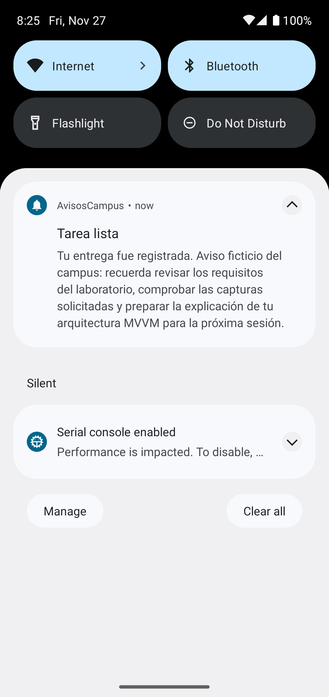
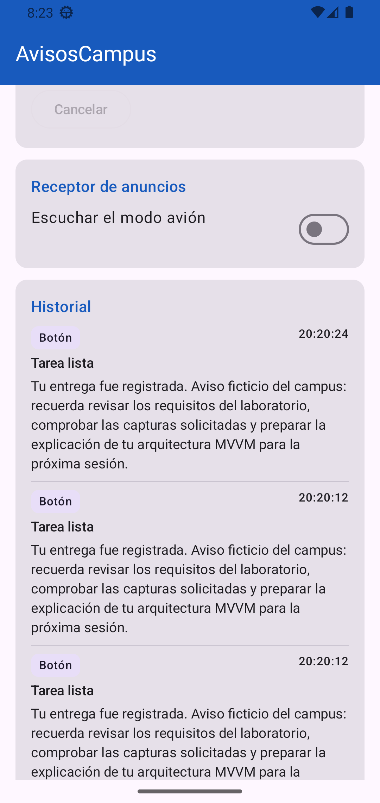
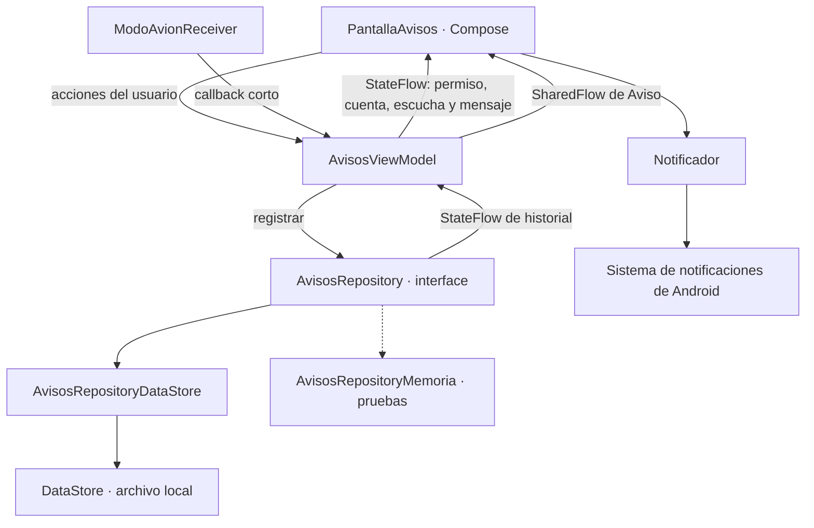
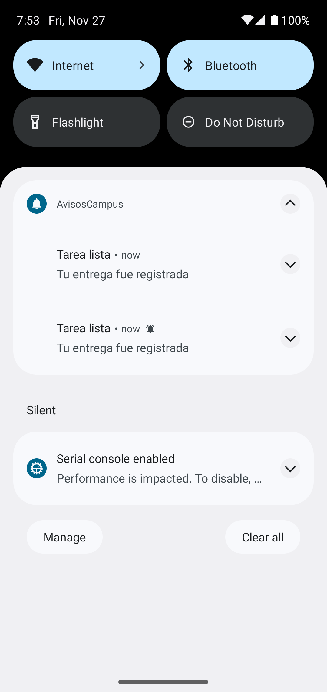
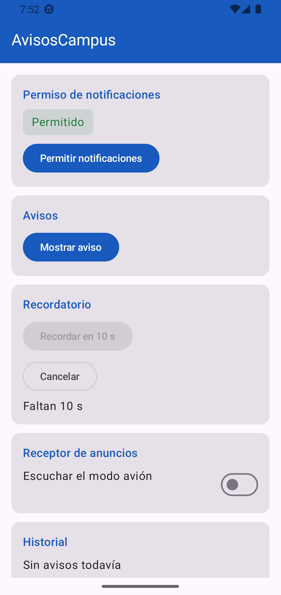
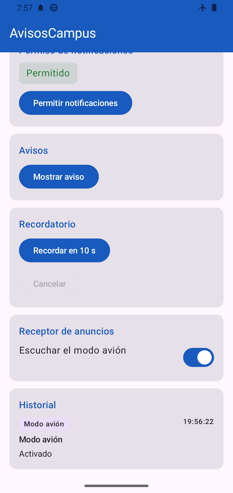
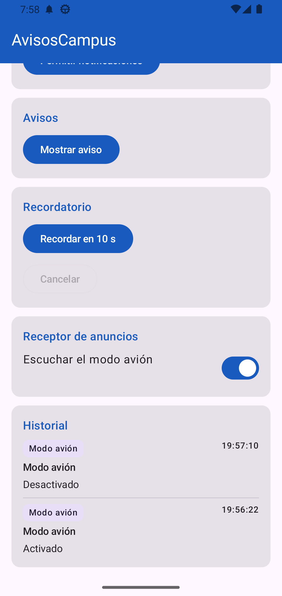
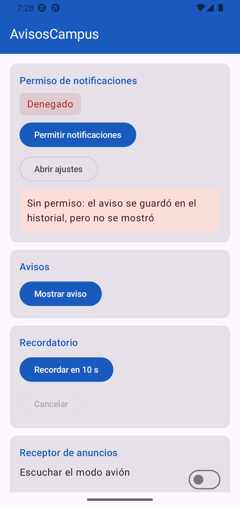

# AvisosCampus

Laboratorio de la Semana 15 de Programación en Móviles: notificaciones locales y BroadcastReceiver con Kotlin, Jetpack Compose y Material 3. Todos los datos son ficticios. No necesita internet, cuentas ni claves.

## Ejecutar

Abrir esta carpeta en Android Studio, sincronizar Gradle y ejecutar el módulo `app`. Se requiere JDK 25 para el daemon configurado en el proyecto, SDK 37 y Android 8.0 (API 26) o superior. Para comprobar el permiso POST_NOTIFICATIONS se necesita Android 13 (API 33) o superior.

Este proyecto forma parte del repositorio existente [Moviles-Curso-OAEL](https://github.com/OscarAEL/Moviles-Curso-OAEL), dentro de `Semana15/avisoscampus`.

## Funciones de la FASE 1

1. Crear el canal **Avisos** al iniciar la Application.
2. Pedir el permiso de notificaciones y mostrar Sin pedir, Permitido o Denegado.
3. Mostrar **Tarea lista / Tu entrega fue registrada**, con un ID distinto por aviso.
4. Abrir la app al tocar una notificación y retirarla automáticamente.
5. Recordar en 10 segundos, mostrar la cuenta regresiva y permitir cancelar.
6. Escuchar los cambios del modo avión mediante un switch.
7. Mostrar los 20 avisos más recientes con origen, título, texto y hora.
8. Conservar en el historial los avisos sin permiso y facilitar abrir Ajustes.

La cuenta regresiva y el historial sobreviven a la rotación mediante el ViewModel. En esta fase el historial está en memoria: termina al morir el proceso. El recordatorio usa una corrutina del ViewModel, por lo que funciona al minimizar mientras el proceso siga vivo; no sustituye una alarma persistente y no se garantiza después de forzar la detención, matar el proceso o reiniciar el dispositivo.

## Mejoras de la FASE 2

Rama: `mejora-ia-avisoscampus`.

| Mejora | Comportamiento | Capas |
|---|---|---|
| Dos canales | Los recordatorios usan **Urgentes** con importancia alta; los demás avisos usan **Avisos**. | Notificador |
| Texto expandible | BigTextStyle conserva el cuerpo completo; el botón genera un texto ficticio largo para demostrarlo. | Notificador y ViewModel |
| Historial persistente | DataStore guarda el historial y conserva los IDs al volver a abrir la app. | Repository, Application y ViewModel |
| Rediseño visual Tecsup Cyber-Tech | Identidad visual moderna con logo institucional de Tecsup, SplashScreen animado, paleta Cyber-Tech y subpaneles. | UI, Theme y Drawable |

En esta rama, Application crea una sola instancia de DataStore y la inyecta al Repository. `registrar` es suspend: primero completa la escritura atómica y después el ViewModel emite el evento. Los IDs se calculan dentro de `updateData` para evitar duplicados entre escrituras concurrentes.

Se usa un formato binario local versionado mediante `AvisosSerializer`, sin plugins adicionales de generación de código. Si un archivo es ilegible, no se reemplaza automáticamente con uno vacío; al intentar guardar se muestra un error. Una falla de guardado no publica una notificación que afirme haberse guardado.

La importancia alta permite avisos emergentes según la configuración de Android y del usuario. La persistencia del historial no convierte la corrutina del recordatorio en una alarma que sobreviva al cierre del proceso.

### Rediseño visual: Tecsup Cyber-Tech

Se implementó un rediseño visual de alta fidelidad basado en la identidad oficial de Tecsup:
- **Splash Screen:** pantalla de bienvenida animada con halo cyan, isotipo oficial de Tecsup, tipografía técnica y barra de carga.
- **TopAppBar institucional:** incorpora el imagotipo de Tecsup, separador vertical luminoso y título `AvisosCampus`.
- **Paleta Tecsup Cyber-Tech:** Cyan oficial (`#00A9E0`), Cyan claro (`#3DD3FF`), fondo medianoche (`#050B1A`), tarjetas con gradiente (`#0E1D3A` a `#0A1630`) y micro-bordes luminosos (`#17406B`).
- **Historial con subpaneles:** cada aviso se presenta en una tarjeta oscura individual (`#08122A`) con chip de origen dot-indicator y cifras horarias monoespaciadas.
- **Compatibilidad y arquitectura:** se mantuvo la arquitectura MVVM + Repository, todos los textos y selectores semánticos requeridos por las pruebas, aprobando el 100% de pruebas unitarias e instrumentadas.

Las instrucciones y decisiones de IA están en [PROMPTS.md](PROMPTS.md).

Resultado final de esta rama: **10 pruebas locales y 9 instrumentadas correctas**, además de compilación y Lint. Se comprobó el historial después de detener y reiniciar el proceso.

| Evidencia de mejora | Captura |
|---|---|
| Texto completo expandido |  |
| Historial recuperado después de cerrar el proceso |  |

## Estructura

```text
com.eneque.avisoscampus/
├── AvisosApp.kt
├── MainActivity.kt
├── model/Modelos.kt
├── data/
│   ├── AvisosRepository.kt
│   ├── AvisosRepositoryDataStore.kt
│   └── AvisosSerializer.kt
├── notificacion/Notificador.kt
├── receiver/ModoAvionReceiver.kt
├── viewmodel/
│   ├── AvisosViewModel.kt
│   └── AvisosViewModelFactory.kt
└── ui/
    ├── PantallaAvisos.kt
    ├── HistorialAvisos.kt
    ├── SplashScreen.kt
    └── theme/
```

## MVVM + Repository



El ViewModel depende de la interface del Repository y no contiene Context, NotificationManager ni BroadcastReceiver. El Repository tampoco usa Context. La pantalla recoge el evento y llama al Notificador. El receptor solo entrega el booleano al ViewModel y se retira en `onDispose`.

El permiso real se comprueba antes de notificar; además se comprueba el bloqueo de notificaciones y del canal. El PendingIntent es explícito e inmutable.

## Capturas de la FASE 1

| Caso | Evidencia |
|---|---|
| Notificación en el panel |  |
| Cuenta regresiva |  |
| Modo avión |  |
| Historial |  |
| Permiso denegado |  |

## Validación

Las pruebas automatizadas están en `app/src/test` y `app/src/androidTest`. El resultado de la ejecución y las comprobaciones de aceptación se registran en [docs/PRUEBAS.md](docs/PRUEBAS.md).

```powershell
.\gradlew.bat :app:assembleDebug :app:testDebugUnitTest :app:lintDebug
.\gradlew.bat :app:assembleDebugAndroidTest
```

Las pruebas instrumentadas `AceptacionTest` requieren permiso concedido. `SinPermisoTest` se ejecuta por separado en API 33+ con el permiso restablecido; niega el diálogo nativo, comprueba el historial sin notificación y la recuperación desde Ajustes. Se usan Compose Test y UI Automator para interactuar con la app y el sistema.

## Para pensar

**1. ¿Por qué una notificación necesita un canal y un permiso? ¿Qué pasa si falta cada uno?**

Desde Android 8, el canal agrupa las notificaciones y permite al usuario controlar su importancia, sonido y bloqueo. Sin un canal válido, una app que apunta a esas versiones no puede publicar la notificación. Desde Android 13 se necesita también POST_NOTIFICATIONS: si no se concede, las notificaciones ordinarias no aparecen. Tener permiso no anula un canal bloqueado por el usuario.

**2. ¿Por qué el ViewModel emite un evento y no muestra la notificación él mismo?**

El ViewModel expresa la decisión y registra el aviso; la pantalla realiza el efecto que necesita Context. Así se mantiene separada la lógica de Android, se evitan referencias a una Activity y se puede probar la lógica con pruebas locales.

**3. ¿Qué pasa si usas el mismo ID en dos notificaciones?**

Con la misma etiqueta y el mismo ID, la segunda actualiza o reemplaza a la primera. Usar IDs distintos permite mantener ambas en el panel.

**4. ¿Por qué onReceive debe ser corto y por qué hay que quitar el receptor al salir?**

Normalmente se ejecuta en el hilo principal y debe terminar rápido para no bloquearlo ni provocar un ANR. El receptor entrega el evento mediante un callback; las corrutinas del ViewModel realizan la lógica. Quitar el registro al abandonar la composición evita retener el Context y recibir eventos fuera de su ciclo de vida.

**5. ¿En qué casos usarías una notificación local y en cuáles una push de Firebase?**

Una notificación local sirve para eventos conocidos por el dispositivo, como una acción del usuario o un recordatorio. Una push sirve para información enviada desde un servidor, como un aviso nuevo del campus. Firebase no es necesario para este laboratorio local.

## Git y uso de IA

La FASE 1 se desarrolla en `main`, con un commit por paso (base, pasos 1 a 8 y documentación). La FASE 2 se desarrolla en `mejora-ia-avisoscampus`, nombre acordado para este repositorio compartido con otras semanas.

Según la autorización del docente comunicada por el estudiante, se permite IA en ambas fases. No se presenta el trabajo como realizado sin asistencia. El registro de las mejoras de la segunda fase está en [PROMPTS.md](PROMPTS.md).
